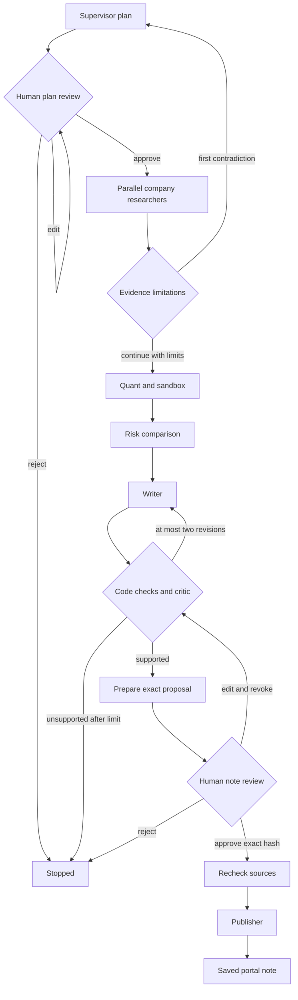

# Implemented CLI research workflow

This diagram describes the current backend, not the unfinished UI, monitoring or
evaluation architecture. All model tool decisions pass through role/scope/budget
checks; source data never supplies approval authority.

The SQLite checkpointer records completed steps and pending interrupts. A
separate journal stores budgets, evidence receipts and scrubbed event metadata.
The human approval capability lives only in the current operator process. Losing
it returns the graph to review; an already completed publication is read back
using its original identifier.

| Role | Model-visible tools or action |
|---|---|
| Supervisor | Plan/replan only |
| Company researcher | Scoped KB search, passage/table reads, EDGAR section reads |
| Quant | Bounded financial collection; code calls EDGAR and sandbox |
| Risk-diff | Scoped search and passage/section reads |
| Writer | Passage reads; structured qualitative draft |
| Critic | Passage reads; code also replays financial facts |
| Publisher | Deterministic draft/read/publish operations; no LLM approval tool |

Financial evidence IDs include the concept, reporting period, filing accession
and receipt fingerprint. Calculations retain input IDs. Passage IDs and original
source fingerprints remain unchanged from the verified retrieval corpus.
