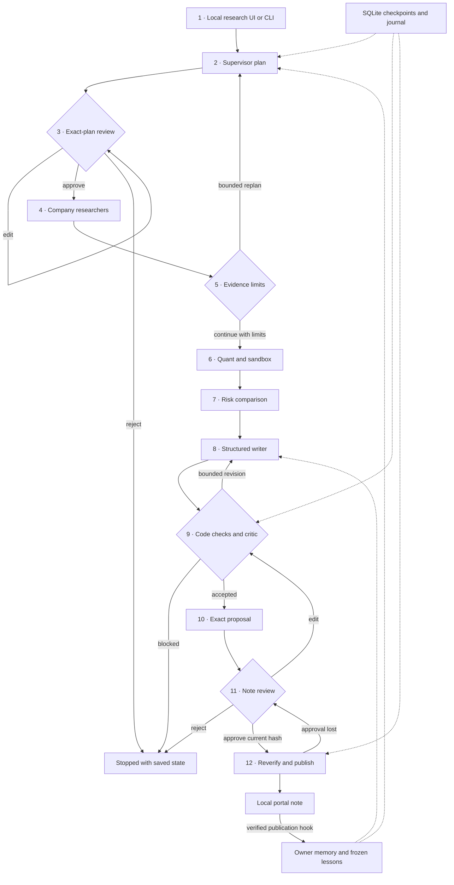

# Analyst Desk architecture and numbered walkthrough

This diagram was redrawn from this project's implementation, including `research_workflow.py`, `workflow_tools.py`, `research_app.py`, `workflow_memory.py` and `workflow_lessons.py`. Solid paths describe implemented workflow transitions; their presence does not imply that every path has completed a fresh live evaluation.

## Request flow

1. **Accept a scoped request.** The authenticated local app validates company/year bounds and explicit budget consent. It creates immutable run inputs and a unique state directory. Source text cannot choose an owner, credentials, endpoint or approval decision.
2. **Make a plan.** The supervisor returns a typed plan. Memory preferences and permitted prior-note summaries can be supplied as bounded background. They do not establish current facts. The run freezes its background and approved lesson manifest.
3. **Pause for a person.** Plan approval binds the exact current hash. An edit changes the review object; a rejection ends execution. The model cannot call an approval tool. Plain `APPROVE` is sufficient for the confirmation text; the interface carries the hash separately.
4. **Collect company evidence.** Company researcher branches use scoped KB search, original passage/table reads and EDGAR section reads. A tool broker enforces roles, request scope and budgets. Returned IDs and hashes identify source records; they are not semantic endorsements.
5. **Handle missing or contradictory evidence.** The join node can return to the supervisor for a bounded replan. Otherwise it preserves limitations for later stages. Saved development journal events 66–69 show an actual replan, although that recovery also involved the operator.
6. **Compute financial quantities.** The quant stage obtains financial facts with provenance and computes values through the bounded sandbox. Input IDs remain attached to calculation records. Financial table values are rendered from those records, rather than accepted from arbitrary narrative numbers.
7. **Compare risks within scope.** The risk stage reads source evidence and passes typed results and eligible evidence references downstream. A passage-level difference is not automatically a company-wide change in business risk.
8. **Write the qualitative draft.** The writer produces structured paragraphs and source references. The renderer combines the validated draft with code-generated financial content. Source instructions have no authority, although S31 showed that a model could still follow them semantically. The writer cannot publish a note directly.
9. **Validate and critique.** Code checks schema, source eligibility, numeric constraints and evidence links. The critic reads selected evidence and returns structured decisions and receipts. The configured automatic writer-revision limit is two. Semantic judgment can still fail: S32 approved an invented guarantee despite exact quotations.
10. **Prepare the exact note.** Current support and source eligibility are checked again, then the deterministic publisher prepares a proposal. Preparation is not publication.
11. **Review or edit the complete note.** The authenticated person sees the final rendered content and current hash. Editing invalidates previous approval and sends the draft back through validation. Review capability remains in the operator process, outside model context, browser payloads and persisted checkpoints.
12. **Reverify before publishing.** Sources and rendered content must still match the approved proposal. A lost process capability returns the run to review. A successful publication is read back by its saved identifier; the memory hook records only verified published material.

## Components and boundaries

| Component | Implemented responsibility | Evidence status |
|---|---|---|
| Local UI and FastAPI app | Authenticated status stream, run management, plan/note gates and memory inspection | Offline tests and actual loopback HTTP with a synthetic controller passed; target Compose and real-model UI run pending |
| LangGraph workflow | Typed stages, parallel company branches, replan/revision edges and persistent interrupts | Source, scripted process-resume tests and saved live S22–S25 continuation |
| Four MCP servers | EDGAR: 4 tools; KB: 5; sandbox: 2; portal: 5 | Actual schema catalog, contract tests and earlier laptop HTTP checks |
| Retrieval | Structured filing passages/tables, BM25, dense, hybrid and reranker fusion | Forty-query development comparison; prepared 45-company-year corpus |
| Memory and lessons | Owner-scoped `SqliteStore`, bounded background, local private watchlists and exact-hash lesson review | Implemented and offline-checked; real-model benefit pending |
| Custom safety checks | Role/scope limits, source-command quarantine, source rechecks and exact-note approval | Regression and saved failure/fix evidence; general attack-resistance rate pending |
| Journal and monitoring | Local event/budget records; Prometheus/Grafana saved-run metrics | Historical dashboard and synthetic alert verified; final deployment pending |

The project uses **custom source guards**, not Llama Guard or Prompt Guard. It uses a **custom local event journal**, not LangSmith traces. These substitutions and their narrower coverage are explicit. The source guard may block benign quoted attack examples, and it does not classify all false facts or all injection forms.

SQLite checkpoints store resumable execution; the journal stores accounting and evidence; owner memory stores durable background. These are distinct records. The dashboard's saved S25 research metrics must not be presented as a live stream of every UI run. [The memory policy](MEMORY_POLICY.md) specifies correction, deletion, context bounds and the limits of private-value checks.
