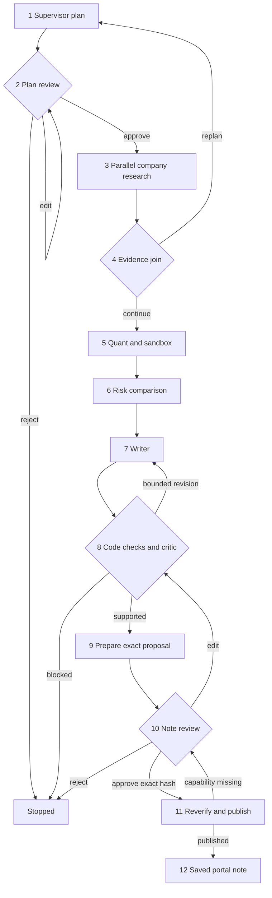

# Architecture and live checkpoint demonstration guide

[Rendered vector graph](diagrams/Workflow_Architecture.svg) | [Editable diagram source](diagrams/Workflow_Architecture.dot)

This is an original redraw of the actual S40 `Workflow.build` edges, with the UI controls around the same persistent backend. The [source copy](source_reference/research_workflow.py) and [source hashes](evidence/Evidence_Manifest.json) identify the implementation. The diagram is implementation evidence; the recording checklist below is not a recorded demonstration.

SQLite checkpoints retain completed nodes and pending interrupts. A separate journal retains evidence, source receipts, events and cumulative budget reservations. The UI authenticates operator controls and streams scrubbed status through SSE. The human publication capability stays in the running trusted process; it is never model context or a persisted approval shortcut. A run continues with its original request/configuration; it does not acquire a fresh budget by restarting.

The planner creates a typed plan. The operator approves its exact hash. Company researchers work in parallel, followed by a join that can request a replan. Quant uses verified financial facts and a constrained computation tool. The risk stage compares supplied evidence. Writer and critic iterate within a fixed revision limit, with deterministic checks retained. Preparation creates an exact proposal. Editing returns to validation; publication requires fresh source eligibility and the exact approval capability. An already published result is read back under its existing identifier.

## What existing evidence establishes

The [saved replan excerpt](evidence/planning/Replan_Exact_Events_66_69.txt) records a real supervisor replan and new plan hash. The [extraction record](evidence/planning/Replan_Extraction_Record.json) binds it to the original source bytes. S22–S25 saved continuation culminated in one explicitly approved local publication. The [three-process resume test](source_reference/test_workflow_clients.py) is additional scripted fixture evidence. Neither was a substitute for the later actual user-run control demonstration recorded below; the backup video remains outstanding.

## Live demonstration checklist

1. Start the prepared local project with `python start_analyst_desk.py`, open `http://127.0.0.1:8080` and unlock without recording any credential. Use an explicitly budget-approved development run, not a held-out case used for tuning.
2. Record the displayed run ID, request, current plan hash and existing cumulative usage. Show that the plan gate requires the operator's own decision; type plain `APPROVE` only after reading it.
3. During execution, select **Pause**. Record the stopped state and retained run ID/usage. If it reaches a human gate first, record that gate and use it as a checkpoint; **Continue** must not bypass it.
4. Restart only the UI process/container using the operator's deployment procedure, preserving its data volume. Reopen the same run. Record the same request/configuration, checkpoint state and cumulative usage. Do not create a replacement run or delete the ledger.
5. Select **Continue** if no review gate is pending, or explicitly review the pending gate. Record subsequent completed stages under the same run ID. A missing in-memory publication capability must return to review rather than publish silently.
6. Retain the unedited screen recording plus the run's scrubbed status/events. Record start/end UTC times, source/config hashes and any error. This supports a live-resume claim only when the actual observed sequence succeeds.

For the separate L14 edit-invalidation demonstration, keep a pre-edit exact hash, edit the note, and attempt the stale decision through the supported review route. Retain the explicit stale-hash rejection and then show the new gate. A fresh edit followed by approval alone does not prove that stale approval was attempted. The deployment/demo owner supplies that actual recording; this guide does not claim it happened.

## Later executed interactive demonstration

The actual [14:49:22 UTC user report](evidence/live_demo/Live_Control_Demo_Report.json) now supplies the resume and edit-invalidation observation described above, using isolated synthetic content. Process 845543 saved checkpoint `1f1e03a7-d31c-64af-8001-809a89f3b92f`; process 845645 reopened the same checkpoint/plan hash with zero additional scripted responses, and the operator rejected it. The separate HTTP/MCP portal proposal was approved, then edited; both attempts to reuse its still-unexpired approval capability returned `approval_required`, with revision 2 pending and zero notes published. No external model calls or production state were used. This completes the controlled demonstration evidence; it is not a video or a financial-research result. The backup recording remains missing.
